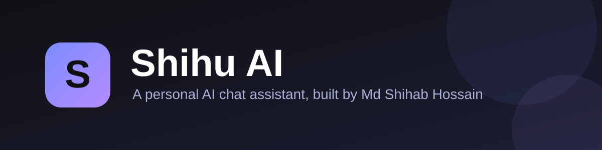

 

**A personal AI chat assistant with saved conversations and a clean, focused interface.**

---

## About

**Shihu AI** is a web-based AI assistant created by [Md Shihab Hossain](https://mdshihabhossain726.github.io/), a Computer Science and Engineering student interested in AI, Data Science, and research.

It is designed to be simple: open the page, ask a question, and get a response. Signing in is optional and lets you keep your conversations and come back to them from any device.

The source code is kept in a private repository, so this public repository documents the project: what it does, how to use it, and where to find it.

## Try it

> **[shihu-ai.onrender.com/chat-ui](https://shihu-ai.onrender.com/chat-ui)**

Because the app is hosted on Render, the very first load after a period of inactivity can take a little longer on some hosting plans. If the page looks slow, give it a moment and refresh.

## Features

| | Feature | Description |
| --- | --- | --- |
| 💬 | **Chat interface** | A simple conversation view for asking questions and reading AI-generated answers. |
| ➕ | **New conversations** | Start a fresh conversation any time with one click. |
| 🗂️ | **Chat history** | Your chats are listed in the sidebar so you can return to earlier conversations. |
| 🔐 | **Accounts** | Sign up or log in with email and password to save chats across devices. |
| ⌨️ | **Keyboard friendly** | Press `Enter` to send and `Shift + Enter` for a new line. |
| 📱 | **Responsive design** | A sidebar layout on desktop and a mobile-friendly account panel on small screens. |
| 🌐 | **Portfolio widget** | Available as an "Ask AI" assistant on my [portfolio](https://mdshihabhossain726.github.io/) for questions about my projects and research. |

## How to use

1. **Open** [Shihu AI](https://shihu-ai.onrender.com/chat-ui) in your browser.
2. **Type** your message in the box at the bottom and press `Enter`.
3. **Sign up or log in** (optional) from the account panel to save your chats and access them on other devices.
4. **Start over** with **New conversation** whenever you want a clean slate.

## Good to know

- AI responses may contain mistakes. Please double-check important information.
- Do not share passwords, financial details, or other sensitive personal information in your chats.

## Feedback

Found a bug or have an idea to make Shihu AI better? Please [open an issue](../../issues) or reach out through my [portfolio](https://mdshihabhossain726.github.io/#contact).

## Author

**Md Shihab Hossain**
CSE student at Bangladesh University of Business and Technology (BUBT)

## License

© Md Shihab Hossain. All rights reserved. This repository is shared for viewing and demonstration purposes only.
